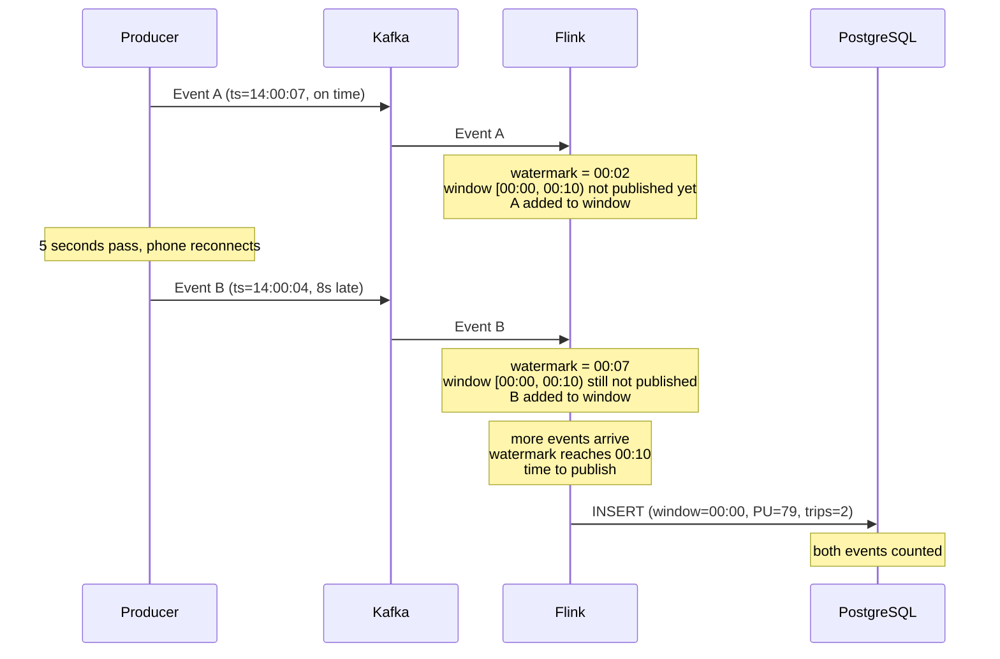
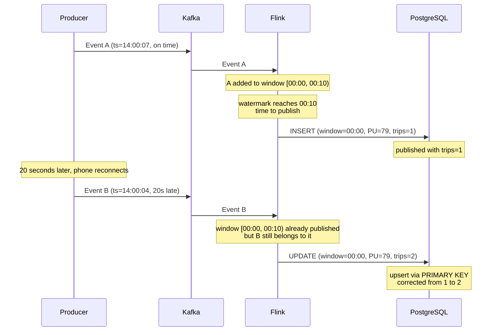

# PyFlink: 스트림 처리 워크숍

영상: https://www.youtube.com/watch?v=YDUgFeHQzJU

이 워크숍은
[Zach Wilson과 함께한 2025년 스트림](https://www.youtube.com/watch?v=P2loELMUUeI)을
바탕으로 합니다.

이 워크숍에서는 실시간 스트리밍 파이프라인을 단계별로 만듭니다.
message broker, producer, consumer라는 기본 요소부터 시작해서
데이터베이스를 추가하고, 마지막으로 스트림 처리 프레임워크를 추가합니다.

데이터 소스로는 NYC yellow taxi trip 데이터를 사용합니다.

최종적으로 만들 구조는 다음과 같습니다.

```
Producer (Python) -> Kafka (Redpanda) -> Flink -> PostgreSQL
```

사전 준비물:

- Docker와 Docker Compose
- [uv](https://docs.astral.sh/uv/)
- SQL 클라이언트 - [pgcli](https://www.pgcli.com/) (`uvx pgcli`), DBeaver, pgAdmin, 또는 DataGrip

코드:

- 이 디렉터리(`07-streaming/workshop/`)의 [참고 코드](./)
- Alexey가 워크숍 중에 [작성한 코드](live/)

README는 모든 것을 처음부터 만들어 가는 과정을 안내합니다. 단계별로 따라 하거나,
이미 있는 파일을 살펴보며 명령어를 실행해도 됩니다.


## Redpanda - Kafka 호환 broker

메시지를 produce하거나 consume하려면 먼저 message broker가 필요합니다.
broker는 producer로부터 메시지를 받아 저장하고, consumer에게 전달하는 서비스입니다.

여기서는 Apache Kafka를 그대로 대체할 수 있는 [Redpanda](https://redpanda.com/)를 사용합니다.
Redpanda는 Kafka와 같은 프로토콜을 구현하므로, 어떤 Kafka 클라이언트
라이브러리든 수정 없이 동작합니다. 우리가 사용할 `kafka-python` 라이브러리는
Kafka 대신 Redpanda가 실행되고 있다는 사실을 알지도, 신경 쓰지도 않습니다.

왜 Kafka 대신 Redpanda를 쓸까요?

- JVM이 없습니다 - Kafka는 Java로 실행되므로 JVM에 상당한 메모리가 필요합니다.
  Redpanda는 C++로 작성되어 오버헤드가 훨씬 적고 몇 초 만에 시작됩니다.
- ZooKeeper가 없습니다 - Kafka는 전통적으로 조정(metadata, leader election)을 위해 별도의
  ZooKeeper 클러스터가 필요했습니다. Redpanda는 이를 Raft consensus 프로토콜로
  내부에서 처리하므로 실행할 서비스가 하나 줄어듭니다.
- 단일 바이너리입니다 - 컨테이너 하나면 되고, 따로 설정할 것이 없습니다.

이 워크숍에서 "Kafka"라고 말할 때는 Kafka 프로토콜과 개념을 뜻합니다.
실제로 아래에서 돌아가는 broker는 Redpanda입니다.

Redpanda 서비스를 넣어 `docker-compose.yml`을 만듭니다.

```yaml
services:
  redpanda:
    image: redpandadata/redpanda:v25.3.9
    command:
      - redpanda
      - start
      - --smp
      - '1'
      - --reserve-memory
      - 0M
      - --overprovisioned
      - --node-id
      - '1'
      - --kafka-addr
      - PLAINTEXT://0.0.0.0:29092,OUTSIDE://0.0.0.0:9092
      - --advertise-kafka-addr
      - PLAINTEXT://redpanda:29092,OUTSIDE://localhost:9092
      - --pandaproxy-addr
      - PLAINTEXT://0.0.0.0:28082,OUTSIDE://0.0.0.0:8082
      - --advertise-pandaproxy-addr
      - PLAINTEXT://redpanda:28082,OUTSIDE://localhost:8082
      - --rpc-addr
      - 0.0.0.0:33145
      - --advertise-rpc-addr
      - redpanda:33145
    ports:
      - 8082:8082
      - 9092:9092
      - 28082:28082
      - 29092:29092
```

command에 매개변수가 많습니다. 하나씩 살펴보겠습니다.

리소스 매개변수:

| 매개변수 | 역할 |
|---|---|
| `--smp 1` | CPU 코어를 1개 사용합니다. Redpanda는 높은 성능을 위해 thread를 코어에 고정하는 프레임워크인 [Seastar](http://seastar.io/) 위에서 만들어졌습니다. 개발용으로는 코어 1개로 충분합니다. |
| `--reserve-memory 0M` | Redpanda 내부 캐시용으로 추가 메모리를 예약하지 않습니다. 운영 환경에서 Redpanda는 자체 page cache용 메모리를 예약하지만, 개발 환경에서는 생략합니다. |
| `--overprovisioned` | thread를 특정 CPU 코어에 고정하지 않습니다. 여러 프로세스가 함께 쓰는 개발 머신에서 다른 프로세스와의 경합을 피할 수 있습니다. |
| `--node-id 1` | 클러스터 안에서 이 broker를 구분하는 고유 식별자입니다. broker가 하나뿐이면 상관없지만, 이 매개변수는 필수입니다. |

네트워크 매개변수:

Redpanda는 Kafka 프로토콜용 listener를 두 개로 나누어 엽니다. 하나는 Docker 내부(다른 컨테이너)에서
오는 연결용이고, 다른 하나는 Docker 외부(여러분의 노트북)에서 오는 연결용입니다.

| 매개변수 | 내부 (Docker) | 외부 (여러분의 노트북) |
|---|---|---|
| `--kafka-addr` | `PLAINTEXT://0.0.0.0:29092` | `OUTSIDE://0.0.0.0:9092` |
| `--advertise-kafka-addr` | `PLAINTEXT://redpanda:29092` | `OUTSIDE://localhost:9092` |

왜 주소가 두 개일까요? Kafka 클라이언트는 두 단계로 연결합니다.

1. 클라이언트가 bootstrap server에 연결해 클러스터 metadata를 요청합니다
2. broker가 advertised address(실제 데이터 전송을 위해 클라이언트가
   접속해야 할 주소)로 응답합니다

Docker 내부에서는 컨테이너가 서비스 이름으로 서로를 찾으므로, 내부 advertised address는
`redpanda:29092`입니다. 노트북에서는 공개된 포트인 `localhost:9092`로 연결합니다.
주소를 하나만 쓰면 Docker 컨테이너나 노트북 중 한쪽은 연결할 수 없습니다.

`--pandaproxy-addr` / `--advertise-pandaproxy-addr`는 Redpanda의 HTTP REST API에 대해
같은 패턴을 따릅니다(이 워크숍에서는 사용하지 않습니다).
`--rpc-addr` / `--advertise-rpc-addr`는 Redpanda 노드 사이의 내부 클러스터
통신용입니다(노드가 하나뿐이면 관계없습니다).

공개 포트:

| 포트 | 용도 |
|---|---|
| `9092` | Kafka 프로토콜(외부) - Python producer/consumer가 여기에 연결합니다 |
| `29092` | Kafka 프로토콜(내부) - 나중에 Flink 컨테이너가 여기에 연결합니다 |
| `8082` / `28082` | HTTP Proxy - REST API 접근용(이 워크숍에서는 사용하지 않습니다) |

Redpanda를 시작합니다.

```bash
docker compose up redpanda -d
```

실행 중인지 확인합니다.

```bash
docker compose ps
```

```
NAME                IMAGE                           SERVICE    STATUS
workshop-redpanda   redpandadata/redpanda:v25.3.9   redpanda   Up
```


## Kafka로 메시지 produce하기

Python 프로젝트를 초기화하고 필요한 dependency를 추가합니다.

```bash
uv init -p 3.12
uv add kafka-python pandas pyarrow
```

> 저장소를 clone했다면 `pyproject.toml`이 이미 있습니다.
> 대신 `uv sync`를 실행하세요.

NYC yellow taxi trip 데이터를 Kafka로 보내겠습니다. 아래 코드는
Python 스크립트로 실행해도 되고, Jupyter notebook에서 실행해도 됩니다(`uv add jupyter`를
실행한 뒤 `uv run jupyter lab`).

먼저 데이터를 다운로드합니다. yellow taxi trip의 parquet 파일을 읽어
처음 1000개 행만 가져옵니다.

```python
import pandas as pd

url = "https://d37ci6vzurychx.cloudfront.net/trip-data/yellow_tripdata_2025-11.parquet"
columns = ['PULocationID', 'DOLocationID', 'trip_distance', 'total_amount', 'tpep_pickup_datetime']
df = pd.read_parquet(url, columns=columns).head(1000)
df.head()
```

내용에 집중하기 위해 컬럼은 5개만 읽습니다. 전체 데이터셋에는
훨씬 더 많은 컬럼(요금 내역, rate code, 결제 유형 등)이 있습니다.

메시지를 위한 dataclass를 정의합니다. 이렇게 하면 각 taxi trip의 schema가
명확해집니다.

```python
from dataclasses import dataclass

@dataclass
class Ride:
    PULocationID: int
    DOLocationID: int
    trip_distance: float
    total_amount: float
    tpep_pickup_datetime: int  # epoch milliseconds
```

DataFrame의 행을 `Ride`로 변환하는 함수를 작성합니다. pandas Timestamp를
epoch milliseconds로 변환합니다. 이것이 나중에 Flink가 기대하는
형식입니다.

```python
def ride_from_row(row):
    return Ride(
        PULocationID=int(row['PULocationID']),
        DOLocationID=int(row['DOLocationID']),
        trip_distance=float(row['trip_distance']),
        total_amount=float(row['total_amount']),
        tpep_pickup_datetime=int(row['tpep_pickup_datetime'].timestamp() * 1000),
    )
```

테스트해 봅니다.

```python
ride = ride_from_row(df.iloc[0])
ride
# Ride(PULocationID=186, DOLocationID=79, trip_distance=1.72,
#      total_amount=17.31, tpep_pickup_datetime=1730429702000)
```

다음으로 Kafka에 연결합니다. `bootstrap_servers`는 broker가 연결을 받는
주소입니다. 지금은 노트북(Docker 외부)에서 실행하므로 `localhost:9092`입니다.
broker가 여러 개인 운영 환경에서는 이중화를 위해 여러 개를 나열합니다.
하나가 다운되어도 클라이언트가 다른 broker를 통해 연결할 수 있습니다.

Kafka는 raw bytes로 동작하므로, Python dict를 JSON으로 변환하는
serializer가 필요합니다.

```python
import json
from kafka import KafkaProducer

def json_serializer(data):
    return json.dumps(data).encode('utf-8')

server = 'localhost:9092'

producer = KafkaProducer(
    bootstrap_servers=[server],
    value_serializer=json_serializer
)
```

시험 삼아 ride 하나를 보내 봅니다. `dataclasses.asdict(ride)`는
dataclass를 일반 dict로 변환하고, serializer가 이를 JSON bytes로 바꿉니다.
broker는 처음 사용될 때 `rides` topic을 자동으로 생성합니다.

```python
import dataclasses

topic_name = 'rides'

producer.send(topic_name, value=dataclasses.asdict(ride))
producer.flush()
```

동작하지만 매번 `dataclasses.asdict()`를 호출하는 것은 번거롭습니다.
dataclass를 직접 처리하는 serializer를 만들 수 있습니다.

```python
def ride_serializer(ride):
    ride_dict = dataclasses.asdict(ride)
    json_str = json.dumps(ride_dict)
    return json_str.encode('utf-8')
```

이제 새 serializer로 producer를 다시 만듭니다. `Ride` 객체를
dict로 먼저 변환하지 않고 바로 전달할 수 있습니다.

```python
producer = KafkaProducer(
    bootstrap_servers=[server],
    value_serializer=ride_serializer
)
```

ride 하나를 보내 확인합니다.

```python
producer.send(topic_name, value=ride)
producer.flush()
```

레코드 하나를 보냈습니다. 이제 1000개의 ride를 모두 반복문으로 보내 보겠습니다.

```python
import time

t0 = time.time()

for _, row in df.iterrows():
    ride = ride_from_row(row)
    producer.send(topic_name, value=ride)
    print(f"Sent: {ride}")
    time.sleep(0.01)

producer.flush()

t1 = time.time()
print(f'took {(t1 - t0):.2f} seconds')
```

처음부터 직접 만드는 경우(clone한 저장소의 파일을 쓰지 않는 경우)에는
소스 디렉터리 구조를 만들고 공유 데이터 모델을 저장합니다. producer와
consumer 스크립트가 모두 이 파일에서 import합니다.

```bash
mkdir -p src/producers src/consumers src/job
```

`src/models.py`를 만듭니다.

```python
import json
from dataclasses import dataclass


@dataclass
class Ride:
    PULocationID: int
    DOLocationID: int
    trip_distance: float
    total_amount: float
    tpep_pickup_datetime: int  # epoch milliseconds


def ride_from_row(row):
    return Ride(
        PULocationID=int(row['PULocationID']),
        DOLocationID=int(row['DOLocationID']),
        trip_distance=float(row['trip_distance']),
        total_amount=float(row['total_amount']),
        tpep_pickup_datetime=int(row['tpep_pickup_datetime'].timestamp() * 1000),
    )


def ride_deserializer(data):
    json_str = data.decode('utf-8')
    ride_dict = json.loads(json_str)
    return Ride(**ride_dict)
```

`ride_deserializer`는 다음 단계에서 소개합니다. 파일을 완성된 형태로
두기 위해 여기에 포함했습니다.

> 전체 스크립트는 `src/producers/producer.py`에 있습니다.

실행합니다.

```bash
uv run python src/producers/producer.py
```

약 10초 동안 1000개의 taxi trip이 전송되는 것을 볼 수 있습니다.

```
Sent: Ride(PULocationID=..., DOLocationID=..., trip_distance=..., total_amount=..., tpep_pickup_datetime=...)
...
took 10.23 seconds
```


## Python으로 메시지 consume하기

이제 메시지를 다시 읽어 보겠습니다. consumer는 Kafka에서 raw bytes를 받습니다.
dict로 deserialize한 다음 `Ride`를 수동으로 만드는 대신,
두 작업을 한 번에 하는 함수를 작성합니다.

```python
import json

def ride_deserializer(data):
    json_str = data.decode('utf-8')
    ride_dict = json.loads(json_str)
    return Ride(**ride_dict)
```

샘플 JSON binary 문자열(Kafka가 전달하는 형태)로 테스트합니다.

```python
test_bytes = json.dumps({
    'PULocationID': 186,
    'DOLocationID': 79,
    'trip_distance': 1.72,
    'total_amount': 17.31,
    'tpep_pickup_datetime': 1730429702000
}).encode('utf-8')

ride_deserializer(test_bytes)
# Ride(PULocationID=186, DOLocationID=79, trip_distance=1.72,
#      total_amount=17.31, tpep_pickup_datetime=1730429702000)
```

이제 `ride_deserializer`를 `value_deserializer`로 바로 전달할 수 있습니다.
Kafka가 모든 메시지에 이 함수를 호출하므로 `message.value`는 이미 `Ride`입니다.

consumer로 Kafka에 연결합니다. `auto_offset_reset='earliest'`는
topic의 처음부터 읽기 시작한다는 뜻입니다(이 설정이 없으면 새 consumer는
기본값인 `latest`가 적용되어 새로 들어오는 메시지만 봅니다). `group_id`는 이
consumer group을 식별합니다. Kafka는 group별로 어디까지 읽었는지 기록하므로,
같은 group ID로 다시 시작하면 멈췄던 곳부터 이어서 읽습니다.

```python
from kafka import KafkaConsumer

server = 'localhost:9092'
topic_name = 'rides'

consumer = KafkaConsumer(
    topic_name,
    bootstrap_servers=[server],
    auto_offset_reset='earliest',
    group_id='rides-console',
    value_deserializer=ride_deserializer
)
```

메시지를 읽어서 출력합니다. `value_deserializer`가 `Ride`를 반환하므로
`message.value`는 이미 `Ride` 객체입니다. 추가 변환이 필요 없습니다.

```python
from datetime import datetime

print(f"Listening to {topic_name}...")

count = 0
for message in consumer:
    ride = message.value
    pickup_dt = datetime.fromtimestamp(ride.tpep_pickup_datetime / 1000)
    print(f"Received: PU={ride.PULocationID}, DO={ride.DOLocationID}, "
          f"distance={ride.trip_distance}, amount=${ride.total_amount:.2f}, "
          f"pickup={pickup_dt}")
    count += 1
    if count >= 10:
        print(f"\n... received {count} messages so far (stopping after 10 for demo)")
        break

consumer.close()
```

> 전체 스크립트는 `src/consumers/consumer.py`에 있습니다.

실행합니다.

```bash
uv run python src/consumers/consumer.py
```

```
Listening to rides...
Received: PU=..., DO=..., distance=..., amount=$..., pickup=2025-...
...
... received 10 messages so far (stopping after 10 for demo)
```


## PostgreSQL에 이벤트 저장하기

화면에 출력하는 것은 디버깅에는 충분하지만, 이벤트를 데이터베이스에 저장해
보겠습니다. `docker-compose.yml`에 PostgreSQL 서비스를 추가합니다.

```yaml
  postgres:
    image: postgres:18
    restart: on-failure
    environment:
      - POSTGRES_DB=postgres
      - POSTGRES_USER=postgres
      - POSTGRES_PASSWORD=postgres
    ports:
      - "5432:5432"
```

시작합니다.

```bash
docker compose up postgres -d
```

PostgreSQL에 연결합니다. `pgcli`를 사용하는 경우:

```bash
uvx pgcli -h localhost -p 5432 -U postgres -d postgres
# password: postgres
```

또는 Docker를 통해서도 연결할 수 있습니다.

```bash
docker compose exec postgres psql -U postgres -d postgres
```

이벤트를 저장할 테이블을 만듭니다.

```sql
CREATE TABLE processed_events (
    PULocationID INTEGER,
    DOLocationID INTEGER,
    trip_distance DOUBLE PRECISION,
    total_amount DOUBLE PRECISION,
    pickup_datetime TIMESTAMP
);
```

PostgreSQL 클라이언트 라이브러리를 설치합니다.

```bash
uv add psycopg2-binary
```

`src/consumers/consumer_postgres.py`를 만듭니다.

Kafka consumer를 설정합니다. 이전 단계의 `ride_deserializer`를 그대로 재사용합니다.
`group_id`는 다릅니다. 각 consumer group은 offset을 독립적으로 추적하므로,
console consumer와 PostgreSQL consumer가 각각 모든 메시지를 읽습니다.

```python
from kafka import KafkaConsumer

server = 'localhost:9092'
topic_name = 'rides'

consumer = KafkaConsumer(
    topic_name,
    bootstrap_servers=[server],
    auto_offset_reset='earliest',
    group_id='rides-to-postgres',
    value_deserializer=ride_deserializer
)
```

PostgreSQL에 연결합니다.

```python
import psycopg2

conn = psycopg2.connect(
    host='localhost',
    port=5432,
    database='postgres',
    user='postgres',
    password='postgres'
)
conn.autocommit = True
cur = conn.cursor()
```

`autocommit = True`는 각 INSERT가 즉시 commit된다는 뜻입니다. 행마다
`conn.commit()`을 호출할 필요가 없습니다.

메시지를 읽어서 PostgreSQL에 insert합니다.

```python
from datetime import datetime

print(f"Listening to {topic_name} and writing to PostgreSQL...")

count = 0
for message in consumer:
    ride = message.value
    pickup_dt = datetime.fromtimestamp(ride.tpep_pickup_datetime / 1000)
    cur.execute(
        """INSERT INTO processed_events
           (PULocationID, DOLocationID, trip_distance, total_amount, pickup_datetime)
           VALUES (%s, %s, %s, %s, %s)""",
        (ride.PULocationID, ride.DOLocationID,
         ride.trip_distance, ride.total_amount, pickup_dt)
    )
    count += 1
    if count % 100 == 0:
        print(f"Inserted {count} rows...")

consumer.close()
cur.close()
conn.close()
```

실행합니다(데이터 처리가 끝나면 Ctrl+C를 누르세요).

```bash
uv run python src/consumers/consumer_postgres.py
```

PostgreSQL을 확인합니다.

```sql
SELECT count(*) FROM processed_events;
```

```
 count
-------
  1000
```

동작은 하지만, 무엇이 빠져 있는지 생각해 봅시다.

- 시간 window 단위로 집계하고 싶다면 어떻게 할까요? windowing
  로직을 직접 구현해야 합니다.
- consumer가 죽으면 어떻게 할까요? 중복 처리하거나 데이터를 놓치지 않으려면 offset을
  직접 추적해야 합니다.
- parallelism은 어떻게 할까요? 여러 consumer 인스턴스와
  partition 할당을 직접 관리해야 합니다.
- 다른 sink에 쓰고 싶다면 어떻게 할까요? 목적지마다
  connector 코드를 작성해야 합니다.

바로 여기서 Flink가 등장합니다. 넘어가기 전에 테이블을 비웁니다.

```sql
TRUNCATE processed_events;
```


## 왜 Flink일까요?

Flink는 이런 어려운 부분을 모두 처리해 주는 스트림 처리 프레임워크입니다.

- Windowing - tumbling, sliding, session window를 기본으로 제공합니다
- Checkpointing - 장애 후 상태를 자동으로 복구합니다(수동 offset 추적이 필요 없습니다)
- Parallelism - 여러 worker에 처리를 분산합니다
- Connectors - JDBC, Kafka, filesystem sink를 기본으로 제공합니다(psycopg2 코드가 필요 없습니다)
- SQL 인터페이스 - SQL 쿼리로 스트림 처리를 표현할 수 있습니다

Flink는 Kafka 외에도 REST API, websocket, 파일 시스템 등 다양한 source에 연결할 수 있습니다.
하지만 스트림 처리에서 가장 흔한 source는 Kafka입니다.

대가는 인프라의 복잡성입니다. JobManager와 TaskManager 컨테이너가 필요합니다.
스트리밍 job은 batch 파이프라인을 실행하는 것보다 서버를 소유하는 것에
가깝습니다. 24시간 내내 실행되며 모니터링이 필요합니다. 하지만 단순히
consume해서 쓰는 수준을 넘어서는 작업이라면 Flink는 충분히 값어치를 합니다.


## Flink 이미지와 서비스

Flink는 기본적으로 Python을 지원하지 않습니다. Python, PyFlink, connector JAR이 들어간
커스텀 Docker 이미지가 필요합니다.

Flink 빌드 파일을 다운로드합니다.

```bash
PREFIX="https://raw.githubusercontent.com/DataTalksClub/data-engineering-zoomcamp/main/07-streaming/workshop"

wget ${PREFIX}/Dockerfile.flink
wget ${PREFIX}/pyproject.flink.toml
wget ${PREFIX}/flink-config.yaml
```

> 저장소를 clone했다면 이 파일들은 이미
> `07-streaming/workshop/` 디렉터리에 있습니다.

[`Dockerfile.flink`](https://github.com/DataTalksClub/data-engineering-zoomcamp/blob/main/07-streaming/workshop/Dockerfile.flink)를
보면 무엇을 하는지 알 수 있습니다.

- 공식 Flink 이미지(`flink:2.2.0-scala_2.12-java17`)에서 시작합니다
- uv로 Python 3.12와 PyFlink를 설치합니다
- connector JAR(Kafka, JDBC, PostgreSQL driver)을 다운로드합니다
- PyFlink를 위해 JVM metaspace를 늘리는 커스텀 Flink 설정을 적용합니다

이제 `docker-compose.yml`에 Flink 서비스를 추가합니다. Flink 클러스터에는
두 종류의 프로세스가 있습니다. 하나씩 추가하겠습니다.

JobManager는 coordinator입니다. job을 받고, checkpoint를 관리하며,
task manager에 작업을 할당합니다. 웹 UI(포트 `8081`)로 상호작용하고,
RPC 포트(`6123`)로 job을 제출합니다.

```yaml
  jobmanager:
    build:
      context: .
      dockerfile: ./Dockerfile.flink
    image: pyflink-workshop
    pull_policy: never
    expose:
      - "6123"
    ports:
      - "8081:8081"
    volumes:
      - ./:/opt/flink/usrlib
      - ./src/:/opt/src
    command: jobmanager
    environment:
      - |
        FLINK_PROPERTIES=
        jobmanager.rpc.address: jobmanager
        jobmanager.memory.process.size: 1600m
```

- `build` + `image: pyflink-workshop` - 커스텀 Docker 이미지를 빌드하고
  `pyflink-workshop`이라는 태그를 붙입니다. taskmanager는 다시 빌드하지 않고
  이 같은 이미지를 재사용합니다.
- `pull_policy: never` - `pyflink-workshop`을 Docker Hub에서 pull하려고 하지 않습니다
  (Docker Hub에는 없고, 로컬에서 빌드한 이미지입니다).
- `volumes` - 소스 코드를 컨테이너에 mount해서 이미지를 다시 빌드하지 않고도
  job을 제출할 수 있게 합니다.
- `FLINK_PROPERTIES` - 환경 변수로 전달하는 Flink 설정입니다.
  `jobmanager.rpc.address: jobmanager`는 coordinator가 어디에 있는지 Flink에
  알려 줍니다(`jobmanager`는 Docker 서비스 이름입니다).

TaskManager는 worker입니다. 실제 데이터 처리를 실행합니다.

```yaml
  taskmanager:
    image: pyflink-workshop
    pull_policy: never
    expose:
      - "6121"
      - "6122"
    volumes:
      - ./:/opt/flink/usrlib
      - ./src/:/opt/src
    depends_on:
      - jobmanager
    command: taskmanager --taskmanager.registration.timeout 5 min
    environment:
      - |
        FLINK_PROPERTIES=
        jobmanager.rpc.address: jobmanager
        taskmanager.memory.process.size: 1728m
        taskmanager.numberOfTaskSlots: 15
        parallelism.default: 3
```

- `image: pyflink-workshop` - jobmanager 서비스가 빌드한 이미지를 재사용하므로
  `build`가 필요 없습니다.
- `depends_on: jobmanager` - jobmanager 이후에 시작합니다.
- `--taskmanager.registration.timeout 5 min` - task manager가 시작할 때
  job manager를 찾을 때까지 5분의 여유를 줍니다(서비스가 동시에 시작될 때 유용합니다).
- `taskmanager.numberOfTaskSlots: 15` - 이 task manager는 slot이 15개입니다.
- `parallelism.default: 3` - 기본적으로 각 파이프라인 단계가 3개의 복사본으로
  데이터를 병렬 처리합니다.

task slot은 파이프라인 단계의 병렬 인스턴스 하나를 실행할 수 있는 리소스(메모리, CPU)
단위입니다. slot을 고속도로의 차선이라고 생각하면 됩니다. 차선이 많을수록
한 번에 더 많은 데이터가 흐를 수 있습니다. parallelism 3으로 job을 제출하면
그 job은 slot 3개를 사용합니다. slot이 15개이면 이 task manager 하나에서
그런 job을 5개 동시에 실행할 수 있습니다. 운영 환경에서는 여러 머신에 걸쳐
task manager가 여러 개 있고, 각각이 클러스터에 slot을 제공합니다. 어떤 slot이
어떤 job의 어떤 부분을 실행할지는 job manager가 결정합니다.

Docker를 시작하기 전에 `src/`가 존재하는지 확인하세요. `src/`가 없으면 볼륨 마운트
`./src/:/opt/src`가 root 소유로 디렉터리를 만들어서, 나중에 그 안에 파일을 만들 때
권한 문제가 생깁니다.

```bash
mkdir -p src/job
```

Flink 이미지를 빌드하고 모든 서비스를 시작합니다.

```bash
docker compose up --build -d
```

첫 빌드에는 몇 분이 걸립니다. Python과 PyFlink를 설치하고
connector JAR을 다운로드하기 때문입니다.

서비스 네 개가 모두 실행 중인지 확인합니다.

```bash
docker compose ps
```

```
NAME                  IMAGE                           SERVICE        STATUS
workshop-jobmanager   pyflink-workshop                jobmanager     Up
workshop-taskmanager  pyflink-workshop                taskmanager    Up
workshop-postgres     postgres:18                     postgres       Up
workshop-redpanda     redpandadata/redpanda:v25.3.9   redpanda       Up
```

[http://localhost:8081](http://localhost:8081)에서 Flink 대시보드를 확인하세요.
task manager 1개와 사용 가능한 task slot 15개가 보여야 합니다.


## 통과(pass-through) Flink job

이제 Python consumer가 했던 것과 같은 일을 Flink로 해 봅시다.

producer와 consumer 스크립트와 달리, Flink job은 Jupyter notebook에서 실행할 수
없습니다. `docker compose exec`를 사용해 .py 파일로 Flink 클러스터에 제출합니다.
프로덕션에서 job 제출이 어떻게 이루어지는지는 마지막의 "Flink in production"
절에서 다룹니다.

`src/job/pass_through_job.py`를 만드세요.

Kafka source 테이블입니다.

```python
def create_events_source_kafka(t_env):
    table_name = "events"
    source_ddl = f"""
        CREATE TABLE {table_name} (
            PULocationID INTEGER,
            DOLocationID INTEGER,
            trip_distance DOUBLE,
            total_amount DOUBLE,
            tpep_pickup_datetime BIGINT
        ) WITH (
            'connector' = 'kafka',
            'properties.bootstrap.servers' = 'redpanda:29092',
            'topic' = 'rides',
            'scan.startup.mode' = 'latest-offset',
            'properties.auto.offset.reset' = 'latest',
            'format' = 'json'
        );
        """
    t_env.execute_sql(source_ddl)
    return table_name
```

이것은 Flink SQL DDL 문입니다. 하나씩 살펴보겠습니다.

- `PULocationID`, `DOLocationID`, `trip_distance`, `total_amount`,
  `tpep_pickup_datetime` - producer가 보내는 JSON 필드입니다.
- `'properties.bootstrap.servers' = 'redpanda:29092'` - Docker 내부 네트워크
  주소입니다(`localhost`가 아닙니다. Flink는 Docker 안에서 실행되기 때문입니다).
- `'scan.startup.mode' = 'latest-offset'` - job이 시작된 이후에 도착하는 새
  메시지만 읽습니다.
- `'format' = 'json'` - Flink가 JSON을 자동으로 deserialize합니다.

PostgreSQL sink 테이블입니다.

```python
def create_processed_events_sink_postgres(t_env):
    table_name = 'processed_events'
    sink_ddl = f"""
        CREATE TABLE {table_name} (
            PULocationID INTEGER,
            DOLocationID INTEGER,
            trip_distance DOUBLE,
            total_amount DOUBLE,
            pickup_datetime TIMESTAMP
        ) WITH (
            'connector' = 'jdbc',
            'url' = 'jdbc:postgresql://postgres:5432/postgres',
            'table-name' = '{table_name}',
            'username' = 'postgres',
            'password' = 'postgres',
            'driver' = 'org.postgresql.Driver'
        );
        """
    t_env.execute_sql(sink_ddl)
    return table_name
```

psycopg2도, INSERT 문도 필요 없습니다. 테이블만 선언하면 나머지는 Flink가
처리합니다.

실행 부분입니다.

```python
from pyflink.datastream import StreamExecutionEnvironment
from pyflink.table import EnvironmentSettings, StreamTableEnvironment

def log_processing():
    env = StreamExecutionEnvironment.get_execution_environment()
    env.enable_checkpointing(10 * 1000)  # checkpoint every 10 seconds

    settings = EnvironmentSettings.new_instance().in_streaming_mode().build()
    t_env = StreamTableEnvironment.create(env, environment_settings=settings)

    source_table = create_events_source_kafka(t_env)
    postgres_sink = create_processed_events_sink_postgres(t_env)

    t_env.execute_sql(
        f"""
        INSERT INTO {postgres_sink}
        SELECT
            PULocationID,
            DOLocationID,
            trip_distance,
            total_amount,
            TO_TIMESTAMP_LTZ(tpep_pickup_datetime, 3) as pickup_datetime
        FROM {source_table}
        """
    ).wait()

if __name__ == '__main__':
    log_processing()
```

- Streaming 모드 - job이 새 데이터를 기다리며 계속 실행됩니다.
- `INSERT INTO ... SELECT`가 곧 pipeline입니다. Kafka에서 읽고, timestamp를
  변환하고, PostgreSQL에 씁니다.

`enable_checkpointing(10 * 1000)`은 Flink가 10초마다 job 상태의 snapshot을
저장하도록 합니다. checkpoint에는 Kafka offset(Flink가 어디까지 읽었는지)과
처리 중인 데이터가 담깁니다. job이 중단되면 처음부터 다시 시작하는 대신 마지막
checkpoint에서 재개합니다.

checkpoint는 window를 쓸 때 특히 중요해집니다. 5분 window가 있는데 2분이 지난
시점에 job이 실패했다면, Flink는 offset만 추적하는 것이 아니라 열려 있는
window도 디스크에 serialize합니다. 재시작하면 부분적으로 채워진 window가 그대로
유지된 채 중단된 지점에서 이어서 진행합니다.

트레이드오프는 복원력과 효율성 사이에 있습니다. 1초마다 checkpoint를 하면
Flink가 그 빈도로 전체 상태를 serialize하고 저장해야 해서 비용이 큽니다. 10분마다
checkpoint를 하면 실패 시 최대 10분의 진행분을 잃을 수 있습니다. 대부분의 job에는
10초가 적당한 기본값입니다.

job을 제출합니다.

```bash
docker compose exec jobmanager ./bin/flink run \
    -py /opt/src/job/pass_through_job.py \
    --pyFiles /opt/src -d
```

```
Job has been submitted with JobID 663cff6811b65e97fc1e068d641401f4
```

[http://localhost:8081](http://localhost:8081)에서 Flink UI를 확인하세요. 실행
중인 job이 보일 것입니다.

이 job은 `latest-offset`을 쓰므로 새 메시지를 기다리고 있습니다. 데이터를 보냅니다.

```bash
uv run python src/producers/producer.py
```

PostgreSQL을 조회합니다.

```sql
SELECT count(*) FROM processed_events;
```

앞의 Python consumer 방식과 비교해 보세요. 결과는 같지만, Flink는 checkpoint,
offset 관리, PostgreSQL 쓰기를 자동으로 처리합니다.


## Offset - earliest vs latest

Flink가 Kafka에 연결할 때는 어디서부터 읽기 시작할지 알아야 합니다. 이것이
`scan.startup.mode` 설정입니다.

| 모드 | 동작 |
|---|---|
| `latest-offset` | job이 시작된 이후에 도착하는 메시지만 읽습니다 |
| `earliest-offset` | topic의 맨 처음부터 모든 것을 읽습니다 |
| `timestamp` | 특정 시점부터 읽기 시작합니다 |

`earliest`는 보통 backfill이나 데이터 재작성(restating)에 사용합니다. 실시간
데이터가 아니라 Kafka에 한동안 쌓여 있던 데이터를 Flink로 처리하는 경우입니다.
`latest`는 프로덕션에서 더 흔한 설정입니다. job이 시작되면 웹사이트에서 사람들이
버튼을 클릭하는 등, 소비 중인 이벤트 피드에서 발생하는 새 이벤트만 처리합니다.

우리의 pass-through job은 `latest-offset`을 사용합니다. `earliest-offset`에서는
어떻게 되는지 봅시다.

1. Flink UI에서 실행 중인 job을 취소합니다(job을 클릭한 뒤 Cancel).
2. 테이블을 비웁니다.
   ```sql
   TRUNCATE processed_events;
   ```
3. `src/job/pass_through_job.py`를 편집해 두 offset 설정을 모두 바꿉니다.
   ```
   'scan.startup.mode' = 'earliest-offset',
   'properties.auto.offset.reset' = 'earliest',
   ```
4. 다시 제출합니다.
   ```bash
   docker compose exec jobmanager ./bin/flink run \
       -py /opt/src/job/pass_through_job.py \
       --pyFiles /opt/src -d
   ```
5. 15초 기다린 뒤 확인합니다.
   ```sql
   SELECT count(*) FROM processed_events;
   ```

Flink는 이전 producer 실행분의 데이터를 포함해 topic의 모든 메시지를 읽습니다.
producer를 두 번 실행한 적이 있다면 약 2000개 행이 보일 것입니다(이미 처리된
모든 데이터의 중복입니다).

왜 중복이 생길까요? checkpoint는 특정 job 인스턴스에 한정되기 때문입니다.
취소하고 다시 제출하면 이전 checkpoint를 전혀 모르는 완전히 새로운 job입니다.
`earliest-offset`에서는 처음부터 시작합니다. offset 설정은 시작 시점에만
의미가 있습니다. job이 실행되기 시작하면 checkpoint가 진행 상황을 추적합니다.
하지만 job을 죽이고 새로 만들면 그 checkpoint는 사라집니다.

세 번째 옵션으로 `timestamp` 모드가 있습니다. job이 오후 2시까지는 잘 돌다가
중단되었다면, 정확히 오후 2시부터 다시 시작할 수 있습니다. 처음부터 전부 다시
처리하지 않고, job이 멈춰 있는 동안 도착한 데이터를 놓치지도 않으면서 장애에서
복구할 때 유용합니다.

흔한 프로덕션 패턴(Lambda architecture)은 이렇습니다. 실시간 결과를 위해
streaming job을 `latest-offset`으로 실행하고, job이 중단되면 별도의 batch job으로
그 공백을 backfill합니다. 이렇게 하면 streaming job은 빠르게 유지되고 데이터도
잃지 않습니다.

> 실험을 마치면 offset을 다시 `latest-offset`으로 되돌리세요.


## Tumbling window를 이용한 집계

이제 일반 Python consumer로는 쉽지 않은 일, 즉 window 집계를 해 봅시다. 시간당
pickup 위치별로 택시 운행 횟수를 세고 매출을 합산합니다.

먼저 실행 중인 job을 모두 취소하세요. 그런 다음 PostgreSQL에 집계 테이블을
만듭니다.

```sql
CREATE TABLE processed_events_aggregated (
    window_start TIMESTAMP,
    PULocationID INTEGER,
    num_trips BIGINT,
    total_revenue DOUBLE PRECISION,
    PRIMARY KEY (window_start, PULocationID)
);
```

중요한 설계 선택이 두 가지 있습니다.

1. `PULocationID`를 포함합니다. 시간 window와 pickup 위치 둘 다로 group by하므로
   두 값이 모두 출력에 나타납니다.
2. `PRIMARY KEY` - upsert 동작을 가능하게 합니다. Flink가 같은 window에 대해
   갱신된 개수를 보내면 PostgreSQL은 중복 행을 만드는 대신 기존 행을 업데이트합니다.
   늦게 도착한 이벤트 때문에 Flink가 이미 결과를 내보낸 window를 다시 계산할 수
   있으므로 이것이 중요합니다. upsert를 쓰면 수정된 개수가 이전 값을 자동으로
   대체합니다.

이제 `src/job/aggregation_job.py`를 만듭니다.

```python
from pyflink.datastream import StreamExecutionEnvironment
from pyflink.table import EnvironmentSettings, StreamTableEnvironment


def create_events_source_kafka(t_env):
    table_name = "events"
    source_ddl = f"""
        CREATE TABLE {table_name} (
            PULocationID INTEGER,
            DOLocationID INTEGER,
            trip_distance DOUBLE,
            total_amount DOUBLE,
            tpep_pickup_datetime BIGINT,
            event_timestamp AS TO_TIMESTAMP_LTZ(tpep_pickup_datetime, 3),
            WATERMARK for event_timestamp as event_timestamp - INTERVAL '5' SECOND
        ) WITH (
            'connector' = 'kafka',
            'properties.bootstrap.servers' = 'redpanda:29092',
            'topic' = 'rides',
            'scan.startup.mode' = 'earliest-offset',
            'properties.auto.offset.reset' = 'earliest',
            'format' = 'json'
        );
        """
    t_env.execute_sql(source_ddl)
    return table_name


def create_events_aggregated_sink(t_env):
    table_name = 'processed_events_aggregated'
    sink_ddl = f"""
        CREATE TABLE {table_name} (
            window_start TIMESTAMP(3),
            PULocationID INT,
            num_trips BIGINT,
            total_revenue DOUBLE,
            PRIMARY KEY (window_start, PULocationID) NOT ENFORCED
        ) WITH (
            'connector' = 'jdbc',
            'url' = 'jdbc:postgresql://postgres:5432/postgres',
            'table-name' = '{table_name}',
            'username' = 'postgres',
            'password' = 'postgres',
            'driver' = 'org.postgresql.Driver'
        );
        """
    t_env.execute_sql(sink_ddl)
    return table_name


def log_aggregation():
    env = StreamExecutionEnvironment.get_execution_environment()
    env.enable_checkpointing(10 * 1000)
    env.set_parallelism(3)

    settings = EnvironmentSettings.new_instance().in_streaming_mode().build()
    t_env = StreamTableEnvironment.create(env, environment_settings=settings)

    try:
        source_table = create_events_source_kafka(t_env)
        aggregated_table = create_events_aggregated_sink(t_env)

        t_env.execute_sql(f"""
        INSERT INTO {aggregated_table}
        SELECT
            window_start,
            PULocationID,
            COUNT(*) AS num_trips,
            SUM(total_amount) AS total_revenue
        FROM TABLE(
            TUMBLE(TABLE {source_table}, DESCRIPTOR(event_timestamp), INTERVAL '1' HOUR)
        )
        GROUP BY window_start, PULocationID;

        """).wait()

    except Exception as e:
        print("Writing records from Kafka to JDBC failed:", str(e))


if __name__ == '__main__':
    log_aggregation()
```

Kafka source 테이블에는 pass-through job과 비교해 새로운 줄이 두 개 있습니다.

- `event_timestamp AS TO_TIMESTAMP_LTZ(tpep_pickup_datetime, 3)` - epoch
  밀리초를 timestamp로 변환하는 computed column입니다. `3`은 밀리초 정밀도를
  뜻합니다.
- `WATERMARK for event_timestamp as event_timestamp - INTERVAL '5' SECOND` -
  Flink가 window 결과를 언제 내보낼지 알려 줍니다.

window는 무엇을 세는지, 즉 택시 운행의 1시간 단위 구간을 정의합니다. 하지만
스트림에서는 이벤트가 계속 도착합니다. Flink는 오후 2시~3시 구간의 개수를
내보내기 위해 언제 기다림을 멈춰야 하는지 어떻게 알까요? 일부 이벤트는 늦게
도착하므로 시계만 볼 수는 없습니다. 트리거가 없다면 Flink는 데이터를 영원히
모으기만 하고 PostgreSQL에는 아무것도 쓰지 않을 것입니다.

watermark가 바로 그 트리거입니다. 언제 내보낼지 Flink에 알려 줍니다. SQL에서
보면 다음과 같습니다.

```
WATERMARK FOR event_timestamp AS event_timestamp - INTERVAL '5' SECOND
                                                   ^^^^^^^^^^^^^^^^^^^
                                                   patience = 5 seconds
```

watermark는 항상 Flink가 본 가장 최근 이벤트 timestamp보다 5초 뒤에 있습니다.
watermark가 window의 끝을 지나면 Flink는 그 window의 결과를 내보냅니다. 5초는
뒤처진 이벤트, 즉 window가 끝나기 전에 발생했지만 몇 초 늦게 도착한 이벤트를
위한 여유 시간입니다.

세 요소가 함께 동작합니다.

- Window = 어느 구간으로 셀 것인가(1시간)
- Watermark = 결과를 언제 내보낼 것인가(트리거)
- Upsert (PRIMARY KEY) = 내보낸 뒤에 무언가 도착했을 때 결과를 바로잡는 안전망

구체적인 예를 봅시다. East Village(PU=79)에서 택시 승차가 두 건 있고, window는
10초, watermark는 5초입니다. Event A는 제시간에 도착하고, Event B는 8초
늦습니다(승객의 휴대폰이 터널에서 신호를 잃었습니다).

Event B가 늦게 도착했지만 Flink가 아직 결과를 내보내지 않은 경우입니다. 두
이벤트가 모두 집계됩니다.



Event B는 늦게 도착했지만 Flink의 여유 시간 안이었습니다. Flink가 아직 결과를
내보내지 않았으므로 B가 집계에 포함되었습니다.

그렇다면 Event B가 20초 늦어서 Flink가 이미 결과를 내보낸 뒤에 도착하면
어떻게 될까요?



Flink는 이미 trips=1을 내보냈지만, Event B가 마침내 도착하면 PRIMARY KEY 덕분에
Flink가 수정본을 보낼 수 있습니다. PostgreSQL은 해당 행을 1에서 2로 업데이트합니다.
PRIMARY KEY가 없으면(append-only sink) Event B는 사라집니다. append 모드에서는
Flink가 이미 내보낸 window를 다시 열 수 없기 때문입니다.

트레이드오프는 지연 시간(latency)과 완전성(completeness)입니다. watermark가 크면
늦은 이벤트를 더 오래 기다려 주지만, 결과를 보기까지 더 오래 기다려야 합니다.
5초는 합리적인 기본값입니다. 프로덕션에서는 데이터가 실제로 얼마나 순서가
뒤바뀌어 도착하는지에 따라 이 값을 조정합니다.

pass-through job과의 다른 차이점은 다음과 같습니다.

- sink에 `NOT ENFORCED`가 붙은 `PRIMARY KEY`가 있습니다. 이것이 Flink JDBC
  connector에서 upsert 동작을 가능하게 합니다.
- `earliest-offset` - Kafka에 이미 있는 모든 데이터를 읽습니다.
- `env.set_parallelism(3)` - 3개의 복사본이 데이터를 병렬로 처리합니다.
- `TUMBLE` 함수는 고정 크기에 서로 겹치지 않는 window를 만듭니다.
  `DESCRIPTOR(event_timestamp)`는 `WATERMARK`가 정의된 컬럼을 가리켜야 하고,
  `INTERVAL '1' HOUR`는 window 크기를 정합니다.

제출하고 테스트합니다.

```bash
docker compose exec jobmanager ./bin/flink run \
    -py /opt/src/job/aggregation_job.py \
    --pyFiles /opt/src -d
```

데이터를 보냅니다.

```bash
uv run python src/producers/producer.py
```

window가 닫힐 때까지 약 15초 기다린 뒤 확인합니다.

```sql
SELECT window_start, count(*) as locations, sum(num_trips) as total_trips,
       round(sum(total_revenue)::numeric, 2) as revenue
FROM processed_events_aggregated
GROUP BY window_start
ORDER BY window_start;
```

```
     window_start     | locations | total_trips | revenue
----------------------+-----------+-------------+---------
 2025-11-01 00:00:00  |        ...
 2025-11-01 01:00:00  |        ...
 ...
```

1000건의 택시 운행이 pickup 위치별로 1시간 tumbling window에 묶였습니다. 각 행은
해당 시간에 운행이 있었던 위치가 몇 곳인지, 그리고 전체 운행 횟수가 얼마인지
보여 줍니다.

일반 Python consumer로 이것을 해 보세요. window 로직을 구현하고, 늦은 이벤트를
처리하고, 상태를 관리하고, upsert SQL까지 직접 작성해야 합니다. Flink에서는
SQL 쿼리 하나면 됩니다.


## 늦은 이벤트(late events)와 upsert

CSV producer는 이벤트를 순서대로 보내므로 watermark가 늦게 도착하는 이벤트를
처리할 일이 없습니다. 가끔 지연이 있는 합성 이벤트를 생성하는 실시간 producer로
어떤 일이 일어나는지 봅시다.

실시간 producer를 다운로드해 실행합니다.

```bash
PREFIX="https://raw.githubusercontent.com/DataTalksClub/data-engineering-zoomcamp/main/07-streaming/workshop"
wget ${PREFIX}/src/producers/producer_realtime.py -P src/producers/
```

```bash
uv run python src/producers/producer_realtime.py
```

이 producer는 현재 timestamp로 무작위 택시 운행을 생성하지만, 이벤트의 약 20%는
3~10초 과거의 timestamp로 보냅니다(네트워크 지연을 시뮬레이션합니다). 출력에는
각 이벤트가 표시됩니다.

```
  on time   -> PU=79 ts=14:23:05
  on time   -> PU=107 ts=14:23:05
  LATE (8s) -> PU=234 ts=14:22:58
  on time   -> PU=48 ts=14:23:06
```

5초 watermark와 1시간 window에서는 버려지는 이벤트가 없습니다. 10초 늦은
이벤트도 현재 1시간 window 안에 충분히 들어가기 때문입니다. 그래도 watermark와
upsert의 동작은 볼 수 있습니다. Flink는 watermark가 window의 끝을 지날 때 먼저
window 결과를 내보내고, 이후 늦은 이벤트가 PRIMARY KEY를 통해 그 결과를
갱신합니다.

이를 직접 확인하려면 터미널 두 개를 엽니다.

터미널 1 - 실시간 producer를 실행합니다.

```bash
uv run python src/producers/producer_realtime.py
```

터미널 2 - 집계 개수가 바뀌는 것을 지켜봅니다.

```bash
watch -n 1 'PGPASSWORD=postgres docker compose exec postgres psql -U postgres -d postgres -c "SELECT window_start, sum(num_trips) as trips, round(sum(total_revenue)::numeric, 2) as revenue FROM processed_events_aggregated GROUP BY window_start ORDER BY window_start;"'
```

늦은 이벤트가 도착해 upsert로 집계를 갱신하면서 이전 window의 개수가 늘어나는
것을 볼 수 있습니다. 그래서 PRIMARY KEY를 설정한 것입니다. 이것이 없으면 늦은
이벤트는 버려지거나 중복을 만들게 됩니다.


## window 종류 이해하기

위에서는 tumbling window를 사용했습니다. Flink는 세 가지 종류를 지원합니다.

### Tumbling window

고정 크기에 서로 겹치지 않습니다. 모든 이벤트는 정확히 하나의 window에
속합니다. batch 세계에서 왔다면 tumbling window가 가장 익숙할 것입니다. 데이터를
고정된 구간으로 자를 뿐이며, 본질적으로 batch 처리를 빠르게 만드는 방법입니다.

```
|  Window 1  |  Window 2  |  Window 3  |
|  1 hour    |  1 hour    |  1 hour    |
```

사용 사례: 시간당 운행 횟수 집계, 일별 매출 요약.

### Sliding window

고정 크기이며 서로 겹칩니다. 하나의 이벤트가 여러 window에 속할 수 있습니다.
1시간 window라고 하면 대부분 00:00-01:00을 떠올립니다. 하지만 00:15-01:15,
00:30-01:30도 시작 지점만 다른 1시간 window입니다. sliding window는 이 모두를
포착합니다.

```
|--- Window 1 (1 hour) ---|
      |--- Window 2 (1 hour) ---|
            |--- Window 3 (1 hour) ---|
      <- 15 min slide ->
```

```sql
HOP(TABLE events, DESCRIPTOR(event_timestamp), INTERVAL '15' MINUTE, INTERVAL '1' HOUR)
```

사용 사례: 최고점과 최저점 찾기 - "어느 1시간 구간에서든 트래픽이 가장 많았던
때는 언제인가?" 이렇게 겹치는 window를 쓰면 값이 가장 높거나 낮은 시점을 찾을 수
있습니다. 최소/최대값 찾기, 이동 평균, 급증 감지(예: 차량 호출 서비스의 surge
pricing)에 적합합니다.

### Session window

비활동 간격(gap)을 기준으로 하는 동적 window입니다. tumbling window나 sliding
window와 달리 window 크기가 고정되어 있지 않습니다. 정해진 시각에 닫히는 것이
아니라, 정해진 시간 동안 활동이 없으면 닫힙니다.

```
|--events--| gap |--events------| gap |--events--|
| Session 1|     |  Session 2   |     | Session 3|
```

사용 사례: 사용자 행동을 묶어서 보기. 사용자가 앱에 로그인해 여러 버튼을 누르고,
2분 동안 자리를 비웠다가 돌아온다고 생각해 보세요. 기술적으로는 여전히 같은
세션입니다. session gap(예를 들어 30분 동안 활동 없음)을 정해 두면 Flink가 그
세션 안의 모든 이벤트를 하나로 묶습니다. sessionization은 행동 분석에 매우
강력합니다.


## Cleanup

모든 컨테이너를 중지하고 제거합니다.

```bash
docker compose down
```

PostgreSQL 데이터 volume까지 함께 제거하려면 다음을 실행합니다.

```bash
docker compose down -v
```


## Q&A

[Zach Wilson과 함께한 2025 스트림](https://www.youtube.com/watch?v=P2loELMUUeI)에서
나온 질문과 답변입니다.

### Flink job이 죽었다가 재시작하면 어떻게 되나요? 모든 것을 다시 처리하나요?

`earliest` offset 설정은 최초 시작에만 적용됩니다. job이 재시작되면(새 job으로
다시 제출한 것이 아니라면) checkpoint를 이용해 마지막 snapshot에서 재개합니다.
checkpoint가 없다면 `earliest`로는 모든 것을 다시 처리하거나, `latest`로는
데이터를 건너뛰게 됩니다.

주의할 점은 checkpoint가 특정 job 인스턴스에 한정된다는 것입니다. job을 완전히
죽이고 새 job을 제출하면, 새 job은 이전 checkpoint를 알지 못합니다. 재배포 후에도
상태를 유지하려면 새 job을 만들지 말고 기존 job을 재시작하세요.

### 그냥 Kafka consumer를 쓰면 안 되나요? Flink는 실제로 무엇을 더해 주나요?

단순한 통과(메시지를 읽어서 어딘가에 쓰기)에는 Kafka consumer로 충분합니다. time
window, watermark, checkpoint, 병렬 처리가 필요한 작업이라면 Flink 덕분에 그
모두를 직접 만들 필요가 없습니다.

일반 consumer로도 windowing, watermarking, 늦은 데이터 처리, job 복구를 할 수
있습니다. 직접 관리하면 됩니다. 하지만 Zach의 말처럼 "행운을 빕니다." 일반
consumer라면 checkpoint도 직접 추적해야 합니다. 마지막으로 처리한 timestamp를
파일이나 데이터베이스에 저장하고 재시작할 때마다 관리해야 합니다. Flink는 상태를
대신 유지해 줍니다.

"Pandas를 쓸 수 있는데 왜 Spark를 쓰나요?"라고 묻는 것과 같습니다. 쓸 수는
있지만, Pandas는 더 큰 규모에서 분산 방식으로는 동작하지 않습니다.

### watermark를 넘어서 지연된 이벤트("터널" 시나리오)는 어떻게 되나요?

지연에는 두 종류가 있습니다. watermark는 허용 가능한 지연, 즉 이벤트가 몇 초
늦게 도착하는 작은 지연을 처리합니다. 훨씬 늦게 도착하는 이벤트(예를 들어 5분짜리
터널을 지난 뒤)에 대해서는 Flink에 allowed lateness 파라미터가 있습니다.

기본적으로 allowed lateness는 0이며, watermark가 window를 닫은 뒤에 도착한
이벤트는 버려집니다. allowed lateness를 10분으로 설정하면 Flink는 이전에 닫힌
window를 찾아가 늦은 이벤트를 반영한 새 집계를 만들고, 이를 완전히 새로운
레코드로 sink에 보냅니다. 따라서 sink 쪽에서 중복 제거 로직(upsert 동작을 하는
primary key, 즉 집계 절에서 설정한 것)이 필요합니다.

트레이드오프는 allowed lateness를 쓰면 허용 기간 동안 Flink가 그 모든 window를
디스크에 보관해야 한다는 점입니다.

### 실제로 streaming이 필요한 때는 언제인가요? 많은 경우 micro-batch로 충분합니다.

핵심 질문은 반대편에서 실시간으로 무언가가 일어나는가입니다. 데이터에 따라 무언가를
바꾸는 자동화된 프로세스가 있다면 streaming이 좋은 선택입니다. 사람이 데이터를
보기만 한다면 실시간은 불필요하고 micro-batch가 유지보수하기 더 쉽습니다.

데이터 엔지니어로 일한 10년 동안 Zach에게 streaming이 정말로 필요했던 사례는
말 그대로 두 가지뿐이었습니다. Netflix의 사기/보안 탐지(5분 지연은 해킹당한
계정이 5분 더 방치된다는 뜻입니다)와 Airbnb의 surge pricing(수요와 공급이 빠르게
변합니다)입니다. 나머지는 모두 일별 batch였거나, 지연 시간 요구가 낮은 경우의
매시간 또는 15분마다 도는 micro-batch였습니다.

streaming을 도입하기 전에 운영 비용을 고려하세요. streaming job은 24시간 내내
실행됩니다. 새벽 3시에 장애가 나면 누군가 고쳐야 합니다. 팀에서 Flink를 이해하는
사람이 당신뿐이라면 영원히 그 on-call을 맡게 됩니다. streaming을 구현하기 전에
매니저와 상의하세요. on-call 부담을 나누려면 먼저 팀 전체를 교육해야 합니다.

### Spark Streaming과 Flink Streaming의 차이는 무엇인가요?

오늘날에는 근본적으로 다르지만 앞으로 수렴할 가능성이 높습니다. 핵심 차이는
이렇습니다. Spark Streaming은 micro-batch로, 15~30초마다 맥박처럼 작은 batch
단위로 데이터를 가져옵니다(pull architecture). Flink는 진정한 연속 처리로,
이벤트가 도착하는 대로 흘러갑니다(push architecture). 대부분의 사용 사례에서는
차이가 미미하지만, 진정한 실시간이 필요한 경우에는 Flink의 지연 시간이 더
짧습니다.

micro-batch 간격에 대해 Zach는 Spark에서는 5분마다 도는 것이 너무 잦다고
봅니다. 시작하는 데만 약 1분이 걸려 실제 작업 대비 오버헤드 비율이 나쁘기
때문입니다. 그가 좋아하는 지점은 매시간과 15분마다입니다.

### 프로덕션에서는 job 제출이 어떻게 이루어지나요?

이 워크숍에서는 로컬 파일을 Docker에 마운트하고 `docker compose exec`로 job을
제출합니다. 이것은 개발 편의를 위한 방식입니다. 프로덕션에서는 배포 방식에 따라
job 제출 방법이 다릅니다.

- 관리형 서비스(AWS Kinesis Data Analytics, Google Cloud Dataflow, Confluent
  Cloud) - 웹 콘솔이나 CLI로 JAR 또는 Python zip을 업로드합니다. 클러스터는
  서비스가 관리합니다.
- Kubernetes의 자체 호스팅 Flink - 보통 job 코드를 포함한 Docker 이미지를
  빌드하거나, 시작할 때 S3/GCS에서 job 아티팩트를 가져오는 Flink Kubernetes
  Operator를 사용합니다.
- Standalone Flink 클러스터 - 로컬 파일이나 HTTP/S3 URL을 가리키는 `flink run`
  CLI를 사용합니다. CI/CD pipeline이 job 아티팩트를 S3에 업로드한 다음 그 URL로
  `flink run`을 호출하는 경우가 많습니다.

공통된 패턴은 이렇습니다. 코드는 git에 있고, CI가 아티팩트(JAR, Python zip 또는
Docker 이미지)를 빌드해 레지스트리나 오브젝트 스토어에 올린 뒤, Flink 클러스터가
그것을 가져가도록 트리거합니다.
